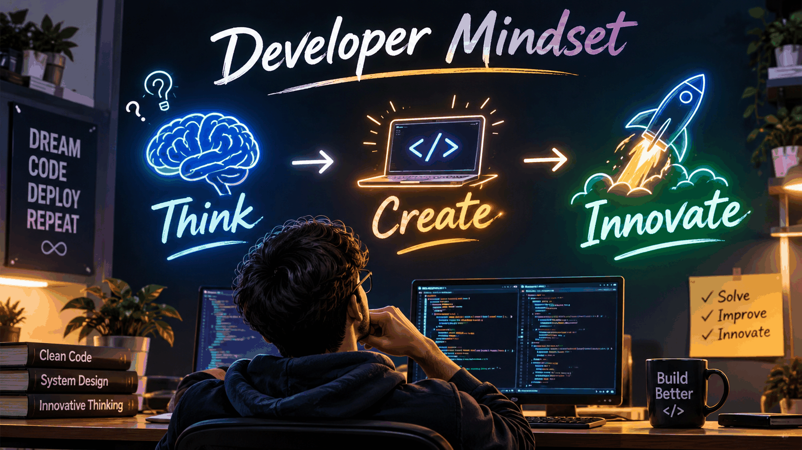

1| 
2| 

3| 
4| 
5| 
6| 
7| 
8|  
9| 
10| <a href="https://github.com/MohammedRiyaz225">
11| 
12| </a>
13| <a href="https://linkedin.com/in/mohammed-riyaz-225">
14| 
15| </a>
16| <a href="mailto:riyazmohammed225@gmail.com">
17| 
18| </a>
19| 
20|   
21| 
22| 
23| 
24| 

25| 
26| 
27| ---
28| 
29| ## 👨‍💻 WHO AM I?
30| 
31| 

32| 
33| ### Hi there! I'm Mohammed Riyaz 👋
34| 
35| **Full Stack Developer | Python Enthusiast**
36| 
37| *Turning creative ideas into intelligent, practical applications.*
38| 
39| 

40| 
41| <table>
42| <tr>
43| <td width="60%" valign="top">
44| 
45| ### 🚀 My Developer Journey
46| 
47| I'm a Computer Science student passionate about building technology that solves real-world problems.
48| 
49| I enjoy working across the development stack, from designing interactive user interfaces to developing backend systems and exploring AI-powered solutions.
50| 
51| - 🔭 Currently building innovative software projects.
52| - 🤖 Exploring Artificial Intelligence and Computer Vision.
53| - 💻 Developing full-stack web and Android applications.
54| - 🧩 Enjoy solving problems through programming.
55| - 🌱 Continuously learning and experimenting with new technologies.
56| - 🎯 Goal: Become a skilled Software Engineer and AI Developer.
57| 
58| </td>
59| <td width="40%" align="center" valign="middle">
60| 
61| 
66| 
67| ### 💡 Developer Mindset
68| 
69| **Think** · **Create** · **Innovate**
70| 
71| </td>
72| </tr>
73| </table>
74| 
75| ### ⚡ Quick Developer Snapshot
76| 
77| 

78| 
79| | Category | Details |
80| |:---|:---|
81| | 👨‍💻 Role | Full Stack Developer |
82| | 🎓 Education | B.Tech – Computer Science |
83| | 🌍 Location | India |
84| | 🧠 Interests | AI, ML, Computer Vision |
85| | 🌐 Development | Web & Android Applications |
86| | ⚡ Philosophy | Build. Learn. Improve. |
87| 
88| 

89| 
90| ### 🎯 What Drives Me
91| 
92| 
93| 
94| 
95| 
96| > "I don't just write code. I build solutions, experiment with ideas, and turn imagination into reality."
97| 
98| ---
99| 
100| ## ⚡ MY TECH ARSENAL
101| 
102| 

103| 
104| ### Programming Languages
105| 
106| 
107| 
108| ### Frontend Development
109| 
110| 
111| 
112| ### Backend Development
113| 
114| 
115| 
116| ### Database & Cloud
117| 
118| 
119| 
120| ### AI & Computer Vision
121| 
122| 
123| 
124| ### Development Tools
125| 
126| 
127| 
128| 

129| 
130| ---
131| 
132| ## 🚀 FEATURED PROJECTS
133| 
134| 

135| 
136| <a href="https://github.com/MohammedRiyaz225/MEDI-">
137| 
138| </a>
139| 
140| <a href="https://github.com/MohammedRiyaz225/Focus-Lens">
141| 
142| </a>
143| 
144| <a href="https://github.com/MohammedRiyaz225/Lovely-Hostel-Assist">
145| 
146| </a>
147| 
148| <a href="https://github.com/MohammedRiyaz225/Medication-Reminder-Agent">
149| 
150| </a>
151| 
152| <a href="https://github.com/MohammedRiyaz225/EVENT-BOOKING-SYSTEM-EBS-">
153| 
154| </a>
155| 
156| 

157| 
158| ---
159| 
160| ## 📊 GITHUB ANALYTICS
161| 
162| 

163| 
164| 
165| 
166| 
167| 
168|   
169| 
170| 
171| 
172|  
173| 
174| 
175| 
176| 

177| 
178| ---
179| 
180| ## 🐍 CONTRIBUTION SNAKE
181| 
182| 

183| 
184| 
185| 
186| 

187| 
188| ---
189| 
190| ## 🏆 GITHUB TROPHIES
191| 
192| 

193| 
194| 
195| 
196| 

197| 
198| ---
199| 
200| ## 🌐 CONNECT WITH ME
201| 
202| 

203| 
204| <a href="https://github.com/MohammedRiyaz225">
205| 
206| </a>
207| 
208| <a href="https://linkedin.com/in/mohammed-riyaz-225">
209| 
210| </a>
211| 
212| <a href="mailto:riyazmohammed225@gmail.com">
213| 
214| </a>
215| 
216|   
217| 
218| ### 💡 "Great things are built one line of code at a time."
219| 
220| 
221| 
222| 

223| 